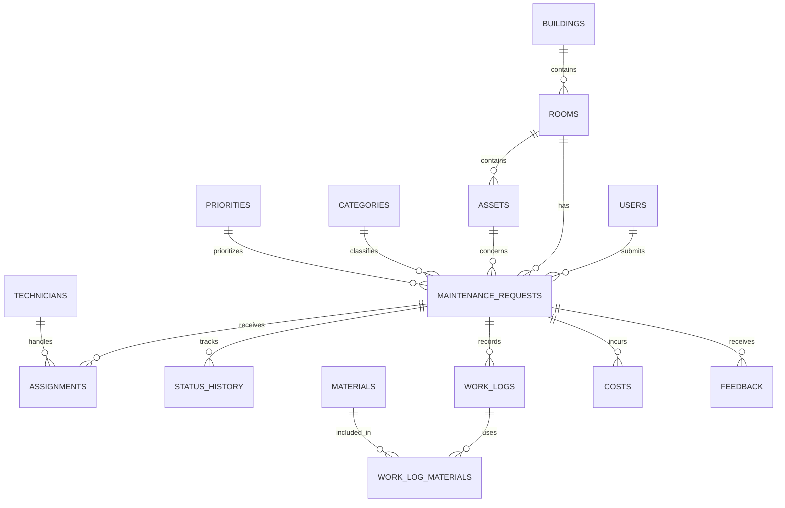

# Campus Facility Maintenance Request Management System

A DBMS-based application designed to manage campus maintenance requests, technician assignments, work progress, material usage, maintenance costs, and user feedback at Woxsen University.

## Project Information

| Detail | Information |
|---|---|
| Project Title | Campus Facility Maintenance Request Management System |
| Project Number | Project 41 |
| Student Name | Sushil Pal |
| Roll Number | 25WU0101141 |
| Section | CSE CORE PANTHERS |
| Faculty Guide | Prof. Sahithi Chennamadhavuni |
| University | Woxsen University |
| School | School of Technology |
| Academic Year | 2026–2027 |

## 1. Introduction

Campus facilities such as classrooms, laboratories, hostels, and other university buildings require regular maintenance. Managing maintenance requests manually can lead to delays, poor communication, difficulty tracking repair progress, and a lack of proper maintenance records.

The **Campus Facility Maintenance Request Management System** provides a centralized way to record maintenance issues, assign technicians, track request status, maintain work logs, record expenses, and collect feedback.

The project uses a relational database to store and organize information and a Java application to interact with the database.

## 2. Problem Statement

Manual maintenance management makes it difficult to track complaints, monitor technician workloads, identify pending requests, calculate maintenance expenses, and maintain historical records.

This project addresses these problems by providing a structured database-driven system for managing campus maintenance activities.

## 3. Objectives

- Create a centralized database for campus maintenance requests.
- Store information about users, buildings, rooms, assets, and maintenance categories.
- Assign maintenance requests to technicians.
- Track request status and status history.
- Record technician work logs, materials used, and maintenance costs.
- Generate reports using SQL queries.
- Collect and store user feedback.
- Improve the organization and traceability of maintenance activities.

## 4. Features

- **Maintenance Request Management:** Record and manage maintenance complaints.
- **User Management:** Maintain user information and roles.
- **Technician Management:** Store technician details and monitor assignments.
- **Building and Room Management:** Organize campus locations.
- **Asset Management:** Maintain records of campus assets.
- **Request Categorization:** Classify requests by maintenance category and priority.
- **Assignment Tracking:** Record technician assignments.
- **Status History:** Track changes in maintenance request status.
- **Work Logs:** Record the work performed by technicians.
- **Material Tracking:** Store details of materials used during maintenance.
- **Cost Management:** Record maintenance-related expenses.
- **Feedback Management:** Store feedback and ratings from users.
- **SQL Reports:** Retrieve pending requests, technician workloads, costs, feedback ratings, and other useful information.

## 5. Technology Stack

| Technology | Purpose |
|---|---|
| Java 17 | Application development |
| Java Swing | Graphical user interface |
| JDBC | Java-to-database connectivity |
| MySQL 8+ | Relational database management |
| Maven | Dependency and project management |
| SQL | Database creation, manipulation, and reporting |
| Mermaid | Entity-relationship diagram representation |

## 6. System Architecture

The application follows a simple database-driven architecture.

```text
+-----------------------------+
|         User                |
+-----------------------------+
              |
              v
+-----------------------------+
|     Java Swing GUI          |
+-----------------------------+
              |
              v
+-----------------------------+
|       JDBC Layer             |
+-----------------------------+
              |
              v
+-----------------------------+
|        MySQL Database        |
|       campus_maintenance     |
+-----------------------------+
              |
              v
+-----------------------------+
| SQL Queries and Reports      |
+-----------------------------+
```

The Java application connects to MySQL through JDBC. The database stores maintenance records and supports queries for retrieving and analyzing information.

## 7. Database Design

The database is named `campus_maintenance`.

The database is organized into related tables to reduce unnecessary duplication and maintain relationships between campus facilities, maintenance requests, technicians, and work records.

### Main Database Tables

| Table | Description |
|---|---|
| `users` | Stores user information and roles |
| `technicians` | Stores technician information |
| `buildings` | Stores campus building details |
| `rooms` | Stores room information |
| `assets` | Stores campus asset details |
| `categories` | Stores maintenance request categories |
| `priorities` | Stores request priority levels |
| `maintenance_requests` | Stores maintenance requests |
| `assignments` | Records technician assignments |
| `status_history` | Records changes in request status |
| `work_logs` | Stores technician work records |
| `materials` | Stores material information |
| `work_log_materials` | Connects work logs with materials used |
| `costs` | Stores maintenance expenses |
| `feedback` | Stores user feedback and ratings |

### Entity-Relationship Diagram

The following diagram provides a high-level representation of the database relationships. Refer to `docs/ERD.mmd` for the project's ER diagram source.



The diagram summarizes the main relationships. Consult the actual SQL schema for the complete table definitions, keys, and constraints.

## 8. Project Structure

```text
Project41/
├── database/
│   ├── schema.sql
│   ├── seed.sql
│   └── queries.sql
├── docs/
│   └── ERD.mmd
├── src/
│   └── main/
│       └── java/
│           └── com/
│               └── project41/
│                   └── MaintenanceApp.java
├── pom.xml
└── README.md
```

## 9. Installation and Setup

### Prerequisites

Install the following software before running the project:

- Java Development Kit (JDK) 17
- MySQL Server 8 or a compatible version
- Apache Maven
- An IDE such as IntelliJ IDEA, Eclipse, or Visual Studio Code

### Step 1: Clone the Repository

```bash
git clone <YOUR_GITHUB_REPOSITORY_URL>
cd Project41
```

Replace `<YOUR_GITHUB_REPOSITORY_URL>` with your repository URL. Adjust the directory name if your cloned repository uses a different name.

### Step 2: Create the Database

Open MySQL Workbench or the MySQL command-line client.

Run the schema script:

```sql
SOURCE /path/to/database/schema.sql;
```

Replace `/path/to/database/schema.sql` with the actual path to the file on your computer.

**Important:** Review `schema.sql` before executing it. If it contains `DROP TABLE` statements, existing tables and their data may be deleted.

### Step 3: Insert Sample Data

After creating the database, run the seed script:

```sql
SOURCE /path/to/database/seed.sql;
```

Use the actual file path on your computer. The seed script inserts sample records for demonstration and testing.

### Step 4: Configure Database Connection

Configure the following environment variables for the Java application:

```text
DB_URL=jdbc:mysql://localhost:3306/campus_maintenance
DB_USER=your_mysql_username
DB_PASSWORD=your_mysql_password
```

Replace the username and password with your local MySQL credentials.

Keep database credentials private. Do not commit real passwords to a public GitHub repository.

### Step 5: Build the Project

From the directory containing `pom.xml`, run:

```bash
mvn clean package
```

### Step 6: Run the Application

Run the application using your IDE, or use the appropriate Maven command configured for the project.

For example, if the project is configured with the Maven Exec Plugin:

```bash
mvn exec:java -Dexec.mainClass="com.project41.MaintenanceApp"
```

If the required plugin is not configured, run `MaintenanceApp.java` through your IDE or configure the appropriate Maven execution command.

## 10. SQL Queries and Reports

The `database/queries.sql` file contains queries for analyzing maintenance information.

Examples of supported reporting tasks include:

- Listing maintenance requests.
- Finding unresolved maintenance requests.
- Identifying ageing requests.
- Checking technician workloads.
- Calculating maintenance costs.
- Reviewing user feedback ratings.
- Counting requests by maintenance category.
- Identifying requests that exceed their response targets.

These reports help organize maintenance information and demonstrate how SQL can be used to retrieve meaningful data from a relational database.

## 11. Testing

The following checks can be performed to evaluate the application and database:

- Verify that the database and tables are created successfully.
- Check whether sample data is inserted correctly.
- Verify that the Java application can connect to MySQL.
- Test the retrieval of maintenance requests.
- Verify technician assignment records.
- Check status history and work logs.
- Test material usage and maintenance cost queries.
- Execute the reporting queries and inspect their results.
- Check how the application handles invalid inputs and database connection errors.

These are suggested validation checks; they should be marked as completed only after they have actually been performed.

## 12. Limitations

- The application depends on a working MySQL database connection.
- Database credentials must be configured correctly.
- The system uses sample data for demonstration.
- Features available in the interface depend on the implemented Java application functionality.
- Advanced notifications, automated scheduling, and integrations may require further development.

## 13. Future Enhancements

Potential improvements include:

- Role-based access control for students, staff, administrators, and technicians.
- Email or in-app notifications when request status changes.
- A dashboard showing pending, completed, and overdue requests.
- Search, filtering, and pagination for maintenance records.
- Automated technician assignment based on workload.
- Exportable maintenance reports.
- Enhanced validation and exception handling.
- Deployment to a server for access across campus.

## 14. Conclusion

The Campus Facility Maintenance Request Management System demonstrates the use of database management concepts in a practical campus scenario. By organizing maintenance requests, technicians, locations, work logs, materials, costs, and feedback in a relational database, the project provides a foundation for tracking and analyzing campus maintenance activities.

The project combines Java, Swing, JDBC, MySQL, and SQL reporting to demonstrate application development and relational database design.

## 15. References

- Oracle. Java Documentation. https://docs.oracle.com/en/java/
- Oracle. JDBC Basics. https://docs.oracle.com/javase/tutorial/jdbc/
- MySQL. MySQL Reference Manual. https://dev.mysql.com/doc/
- Apache Maven. Maven Documentation. https://maven.apache.org/guides/

---

**Project:** Campus Facility Maintenance Request Management System  
**Developed by:** Sushil Pal  
**Institution:** Woxsen University — School of Technology  
**Academic Year:** 2026–2027
